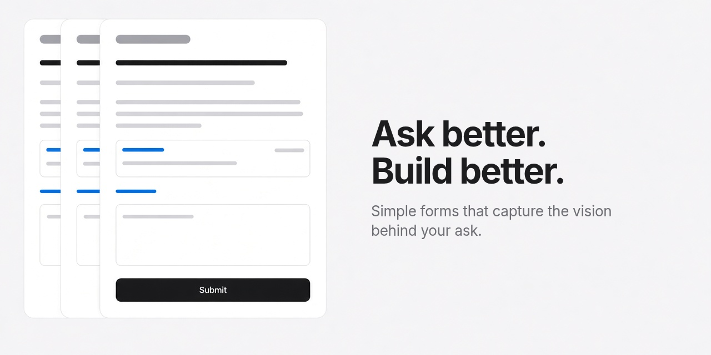

# grokbot-local-forms



> [!TIP]
> **Automate with your agent.**
>
> ```
> Read this README: https://github.com/brett-technical/grokbot-local-forms
> Incorporate this process into our current workflow.
> ```

Local HTML forms for [Grok Bot](https://grok.com). Answers stay on the person's computer. Submit writes a markdown note plus matching JSON, then notifies the assistant named in `target_bot`.

## What it is

A tiny Python stdlib server plus a data-driven page. Copy `example-form/`, write only `form.json`, and run. No framework, no build step.

Every form shows who requested it and who the answers go back to (`From X · your answers go back to Y`).

Every form also shows a quiet tip under the intro reminding people to use speech-to-text dictation, since spoken answers carry more of what they mean.

## Quick start

```bash
# optional: copy webhook.local.json.example → webhook.local.json (repo root)
# then paste the webhook URL and key locally — never commit that file

python example-form/server.py
# or on Windows: example-form/start.ps1
```

Open the URL it prints (usually `http://127.0.0.1:8765/`). If that port is taken, the server picks the next free one.

## Make a new form (token-cheap)

1. Copy `example-form/` to a sibling folder named for the form id (kebab-case).
2. Edit **only** `form.json`. Leave `index.html`, `server.py`, and `start.ps1` alone.
3. Start the server. Open the printed URL in the browser.
4. Dry-run safely: set `FORMS_DIR` to a temp folder and `FORM_DISABLE_WEBHOOK=1`. Never test-submit against a real webhook.

Interview the requesting bot for question text and options. Do not invent them. If [intent](https://github.com/brett-technical/skills/tree/main/skills/intent) and [interview-me](https://github.com/brett-technical/skills/tree/main/skills/interview-me) from [brett-technical/skills](https://github.com/brett-technical/skills) are installed, run them first.

## form.json schema

```json
{
  "id": "kebab-case-id",
  "title": "Human title",
  "intro": "One or two sentences under the title.",
  "target_bot": "Requesting Bot",
  "requested_by": "Optional different requester",
  "sections": [
    {
      "id": "section-id",
      "group": "Optional group heading",
      "title": "Section heading",
      "note": "Optional helper under the heading.",
      "links": [
        {
          "label": "Link label",
          "url": "https://…",
          "note": "One-line why / where it fits.",
          "tag": "optional short tag"
        }
      ],
      "questions": [
        {
          "id": "q-id",
          "prompt": "Question text",
          "options": ["Suggested A", "Suggested B"],
          "multi": false,
          "write_in": true,
          "presentation": "rating",
          "placeholder": "Optional placeholder"
        }
      ]
    }
  ]
}
```

- No `options` (or `[]`): open-ended textarea.
- With `options`: radios (checkboxes if `multi: true`) plus a write-in unless `write_in: false`.
- `presentation: "rating"` (or numeric 1–N options): compact rating row.
- Optional `group` clusters sections under a shared heading.
- Links open in a new tab (`rel=noopener`).

## How Submit works

- Keeps the page open and editable. Shows a short confirmation. Leaves Submit enabled.
- Every Submit (including resubmits) writes a **new** timestamped `.md` + `.json` pair. Never overwrites earlier files.
- Posts the JSON record to the webhook so the `target_bot` gets notified. The on-disk `.json` is a spare if a ping fails.

## Webhook setup

Copy `webhook.local.json.example` to `webhook.local.json` in the **repository root** (one level above the form folder):

```json
{
  "url": "https://…",
  "key": "…"
}
```

Ask the person to paste the routine's Webhook URL and key into that file. Never ask them to paste the key into chat. Never commit `webhook.local.json`. The server rereads it on every Submit (UTF-8 with BOM is fine).

## Configuration

| Env | Default | Purpose |
| --- | --- | --- |
| `FORMS_DIR` | `<form>/submissions` | Where markdown and JSON logs are written |
| `FORM_HOST` | `127.0.0.1` | Bind address (localhost only) |
| `FORM_PORT` | `8765` | Preferred port; next free if taken |
| `FORM_IDLE_SECONDS` | `3600` | Shut down after idle; `0` disables |
| `FORM_DISABLE_WEBHOOK` | unset | `1` / `true` skips the webhook POST |

## Behavior

- Python 3 standard library only. Listens on localhost.
- Preferred port 8765, then the next free port up to +49.
- 1-hour idle timeout (reset on page load or submit). Do not shut the server down on Submit.
- More than one form can run at once; each may use a different port.

## Requirements

- Python 3 (standard library only)
- A Grok Bot assistant with a webhook routine (optional for dry runs)
